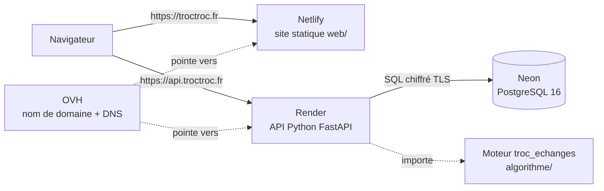
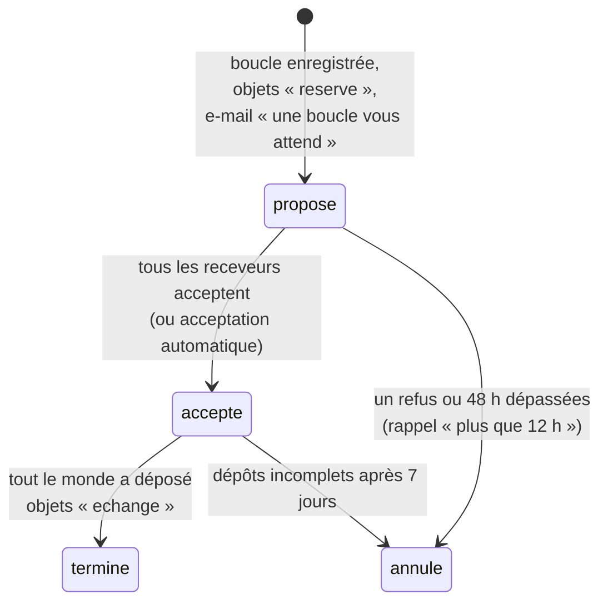

# Architecture

montroc est découpé en quatre briques indépendantes, chacune hébergée là où elle est la plus simple à faire tourner.



| Brique | Dossier | Hébergement | Rôle |
|---|---|---|---|
| Site | `web/` | **Netlify** (gratuit) | Pages HTML/CSS/JS servies telles quelles. Déploiement automatique à chaque fusion dans `main`, aperçu automatique sur chaque pull request. |
| API | `api/` | **Render** (gratuit au départ, Frankfurt) | Python 3.12 + FastAPI. Reçoit les requêtes du site, lit/écrit la base, appelle le moteur. Documentation interactive sur `/docs`. |
| Moteur | `algorithme/` | (dans l'API) | Bibliothèque Python pure qui trouve les boucles d'échange (2 ou 3 personnes) et le « math trade ». Aucune dépendance, testable seule. |
| Base | `api/alembic/` (schéma) | **Neon** (PostgreSQL managé, Frankfurt) | Données : utilisateurs, objets, souhaits, échanges. Sauvegardes et restauration gérées par Neon. |
| Domaine et e-mails | — | **OVH** (offre Startup) | `troctroc.fr`, la zone DNS et les adresses e-mail `@troctroc.fr`. |

## Pourquoi ce découpage

- **Netlify n'exécute pas de serveur Python ni de base de données** : il sert des fichiers. L'API et la base vivent donc ailleurs.
- **L'offre OVH Startup sert pour les e-mails et le domaine**, pas pour le site : l'hébergement mutualisé ne fait pas tourner d'API Python (il est fait pour PHP), et Netlify sert le site avec déploiement automatique et aperçus de PR.
- **PostgreSQL managé (Neon)** plutôt qu'une base qu'on administre soi-même : sauvegardes, mises à jour et chiffrement sont pris en charge ; la base respecte des contraintes fortes (voir [Base de données](03-base-de-donnees.md)).
- **Tout est en Europe (Frankfurt)** : latence faible depuis la France, données dans l'UE (RGPD).
- Chaque brique peut être remplacée sans toucher aux autres (ex. passer l'API sur un VPS OVH plus tard : seule l'URL `api.troctroc.fr` change de cible).

## Organisation du code de l'API

```
api/
├── pyproject.toml            dépendances et réglages (ruff, pytest)
├── alembic.ini, alembic/     migrations de la base (historique du schéma)
├── src/montroc_api/
│   ├── main.py               création de l'application, CORS, route /sante
│   ├── config.py             réglages lus dans les variables d'environnement
│   ├── db.py                 connexion à PostgreSQL
│   ├── deps.py               session de base, utilisateur connecté, modérateurs, secret des tâches
│   ├── models.py             tables et contraintes (SQLAlchemy)
│   ├── schemas.py            formats JSON d'entrée/sortie (Pydantic)
│   ├── services.py           logique métier : base ⇄ moteur d'échanges, délais, dépôts
│   ├── courriels.py          e-mails des moments clés (API Brevo, ou SMTP), envoyés après validation
│   ├── vues.py               réponses qui dépendent du lecteur (codes de retrait)
│   └── routers/              une route par ressource
│       ├── auth.py           /auth (lien magique, session, déconnexion)
│       ├── moi.py            /moi : profil, mes objets, souhaits, boucles possibles, échanges, photos
│       ├── catalogue.py      /categories
│       ├── objets.py         /objets (catalogue public)
│       ├── utilisateurs.py   /utilisateurs/{id} (profil public)
│       ├── echanges.py       /echanges (proposer, répondre, déposer)
│       ├── signalements.py   /signalements et /moderation
│       └── taches.py         /taches (rappels, expirations, math trade : appelées par GitHub Actions)
└── tests/                    tests sur une vraie base PostgreSQL
```

Le chemin d'une requête : **route** (`routers/`) → valide le JSON (`schemas.py`) → appelle le **service** (`services.py`) → qui lit les **modèles** (`models.py`) et appelle le **moteur** (`troc_echanges`) → la route renvoie le JSON.

## Cycle de vie d'un échange



Chaque passage envoie un e-mail aux participants concernés. Pendant les dépôts, chaque donneur voit le code à écrire sur son paquet ; le receveur ne reçoit ce code qu'une fois **tout** déposé, ce qui garantit que personne ne repart avec un objet sans avoir donné le sien.

## Connexion

Pas de mot de passe. `POST /auth/lien` envoie un lien `https://troctroc.fr/#connexion=…` valable 20 minutes et à usage unique ; le site l'échange contre un jeton de session de 30 jours (`POST /auth/verifier`), gardé dans le navigateur et envoyé dans l'en-tête `Authorization: Bearer …`. À la première connexion, l'API demande un pseudo et une ville. La base ne stocke que l'empreinte (SHA-256) des jetons. Toutes les routes personnelles sont sous `/moi` : l'API ne fait jamais confiance à un identifiant d'utilisateur envoyé par le navigateur.

## Photos

Le navigateur réduit la photo (1600 px, ce qui efface aussi la position GPS), demande une signature à l'API (`GET /moi/photos/signature`) et l'envoie **directement** à Cloudinary : l'API ne transporte aucune image. Elle n'accepte ensuite que des adresses de notre compte Cloudinary.

## Ce qui n'est pas encore fait

Voir la feuille de route dans [Git, branches et pull requests](05-git-et-branches.md#feuille-de-route).
